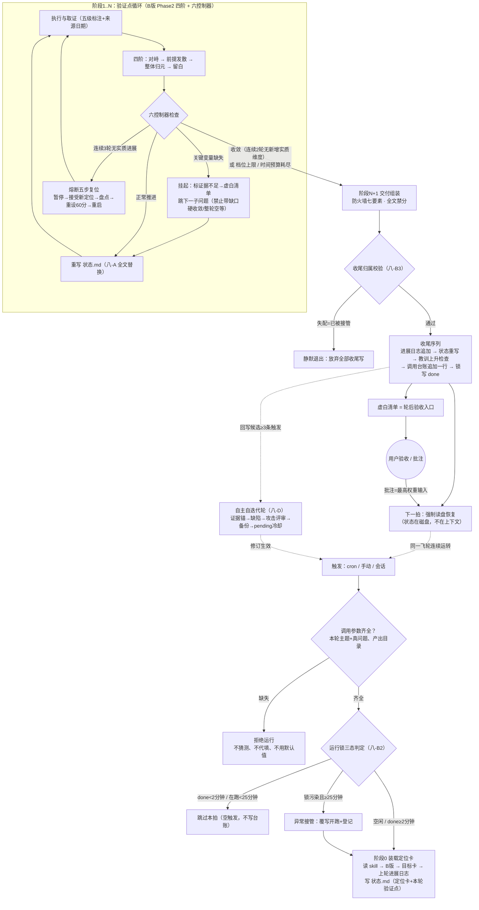

# 归元夜航运行逻辑图（v1.3）

> 单次调用（拍/轮）全流程 + 跨轮飞轮 + 自迭代外环。支持 Mermaid 渲染的 Markdown 阅读器可直接显示下图。

## 读图要点

| 区域 | 对应机制 | 防的失效 |
|---|---|---|
| 入口三闸 | 参数缺失拒跑 / 运行锁三态 | 无目标空跑；多实例互踩 |
| 验证点循环 | B 版四阶+六控制器 | 空转（熔断/封顶）；妥协（挂起不许硬收敛）；假收敛（实质维度判据） |
| 交付组装 | 输出防火墙 | 幻觉数字外流、自评分 |
| 收尾序列 | 归属校验→四步落盘→写 done | 双实例互踩收尾；对下一拍不可见 |
| 外环两条虚线 | 跨轮读盘恢复 + 自迭代协议 | 上下文失真；系统自身退化 |
| 用户节点 | 虚白清单验收+批注回灌 | 无人值守下的方向漂移（人只做验证视角，不做推进闸门） |
